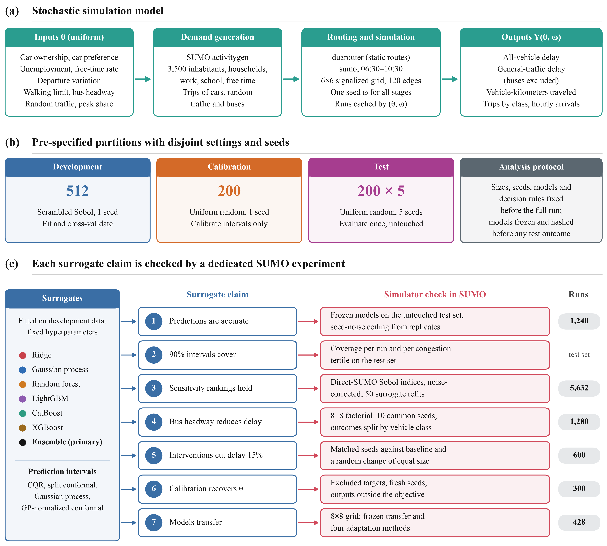
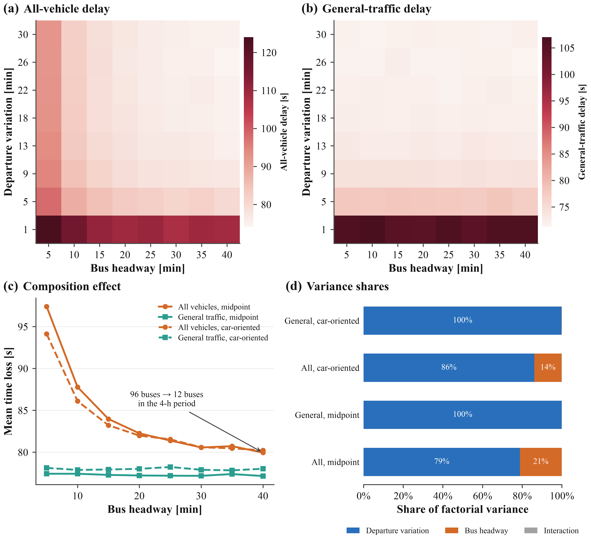

# Validating Explainable Surrogates of SUMO

[](https://www.python.org/)
[](https://eclipse.dev/sumo/)
[](LICENSE)
[](#key-results)

Code, experiment designs, result tables, figures, and reproducibility materials for:

> **Validating Explainable Surrogates of Activity-Based Microscopic Traffic Simulation: Independent Tests, Seed Noise, and Simulator-Checked Interventions in SUMO**

This repository investigates when surrogate models and explainable machine-learning methods can be trusted as substitutes for expensive traffic-simulation experiments. The study evaluates every major claim against fresh Eclipse SUMO simulations rather than relying only on surrogate diagnostics.

## At a glance

- **10,216** Eclipse SUMO simulations
- **0** failed simulation runs
- Independent development, calibration, and test settings
- Explicit quantification of random-seed noise
- Direct-SUMO Sobol sensitivity analysis
- Simulator-checked interventions and calibration results
- Frozen transfer evaluation on an unseen **8 × 8** network
- Resumable workflows with cached simulator runs and SHA-256 manifests

## Contents

- [Study overview](#study-overview)
- [Key results](#key-results)
- [Repository layout](#repository-layout)
- [Reproduce the study](#reproduce-the-study)
- [Outputs](#outputs)
- [Scope and limitations](#scope-and-limitations)
- [License and citation](#license-and-citation)

## Study overview

<p align="center">
  
</p>

| Research question | Experimental design |
|---|---|
| How accurate are surrogates on new settings? | 512 Sobol development settings, plus 200 independent calibration and 200 independent test settings. Models are frozen and hashed before testing. |
| How much output variation is seed noise? | 24 settings × 10 seeds and 200 test settings × 5 seeds; noise share, R² ceiling, and RMSE floor are estimated. |
| Do prediction intervals cover new runs? | CQR, split conformal, Gaussian process, and GP-normalized conformal intervals evaluated on untouched test data. |
| Do surrogate explanations describe the simulator? | Direct-SUMO Sobol indices with seed-noise correction, compared with surrogate Sobol, SHAP, and ALE across 50 refits. |
| What does bus headway actually do? | An 8 × 8 × 10-seed factorial experiment varying headway and departure variation at two background settings. |
| Do surrogate-proposed interventions work? | Candidate interventions are re-simulated with 10 matched seeds against the baseline and a random same-distance control. |
| Can parameters be recovered by calibration? | Ten excluded targets, two objective configurations, fresh-seed validation, and an equifinality scan. |
| Do surrogates transfer to another network? | Frozen transfer to an 8 × 8 grid, followed by evaluation of four adaptation methods. |

## Key results

### 10,216 SUMO runs · 0 failures

| Finding | Result from fresh simulations |
|---|---|
| **Generalization** | Frozen ensemble single-run test R² = **0.937** for all-vehicle delay, **0.941** for general-traffic delay, and **0.991** for VKT. Ridge achieved 0.478 / 0.417 / 0.945. |
| **Simulator noise limit** | Seed-noise SD = **1.6 s** for delay; ensemble test RMSE = **2.3 s**; estimated R² ceiling = **0.969**. |
| **90% interval coverage** | **0.80–0.90** overall for delay, decreasing to **0.70–0.75** in the most congested tertile. |
| **Direct-SUMO sensitivity** | Total-order Sobol indices: departure variation **0.74** and bus headway **0.21** for all vehicles; headway **0.014** for general traffic. |
| **Bus headway mechanism** | Longer headways remove buses (**−84 vehicles**), reducing the all-vehicle mean by **17 s** while leaving general-traffic delay essentially unchanged (**−0.3 s**, 95% interval [−1.3, 0.7]). |
| **Intervention validity** | **20/20** proposed interventions reduced delay in SUMO: **15.8%** observed versus **17.0%** predicted. **10/20** reached the 15% target. Random same-size changes achieved **6.8%**, with **4/20** reaching the target. |
| **Calibration** | Error was **0.29 of the output range** for two aggregate outputs and **0.20** for eight outputs including hourly arrivals, compared with **0.33** for a random guess. |
| **Network transfer** | Frozen transfer produced R² < **−12** with **0%** coverage; residual adaptation using 128 simulations reached R² = **0.93**. |

<p align="center">
  
</p>

## Repository layout

```text
src/sumo_study/        Analysis package
  config.py            Parameter domain, outputs, experiment sizes, seed registry
  simulator.py         activitygen → duarouter → SUMO, parsing, and run cache
  design.py            Sobol / uniform designs and disjointness checks
  surrogates.py        Ridge, GP, RF, LightGBM, CatBoost, XGBoost, and ensembles
  validation.py        Independent tests, noise components, and interval methods
  policy.py            Intervention search and matched-seed evaluation
  calibration.py       Inverse calibration and equifinality scan
  sensitivity.py       Direct-SUMO / surrogate Sobol, SHAP, ALE, and DML
  adaptation.py        8 × 8 transfer adaptation
  workflow.py          Ordered, resumable study stages and CLI
  figures.py            Article figures
  export.py             Key numbers, LaTeX tables, and SHA-256 manifest

notebooks/              SUMO_Surrogate_Study.ipynb — documented ordered study
docs/                   ANALYSIS_PROTOCOL.md — protocol fixed before the full run
results/full/           Tables, figures, designs, LaTeX tables, and key_numbers.json
scripts/                run_study.py and build_notebook.py
```

## Reproduce the study

### Requirements

- Eclipse SUMO **1.28.0** with `sumo`, `netgenerate`, `activitygen`, and `duarouter` available on `PATH`
- Python **3.11 or newer**

### Command-line workflow

```bash
python -m venv .venv
source .venv/bin/activate
pip install -r requirements.txt

# Quick end-to-end check: small sizes, approximately 3 minutes
# Not intended for interpreting scientific results.
python scripts/run_study.py smoke 8

# Full study: 10,216 SUMO runs
python scripts/run_study.py full 8
```

You can also open `notebooks/SUMO_Surrogate_Study.ipynb`. The notebook is designed to run in Google Colab after installing SUMO:

```python
!pip install eclipse-sumo==1.28.0
```

### Reproducibility notes

Study stages are resumable. SUMO runs are cached under `cache/` using a hash of the simulator fingerprint, parameters, and random seed. If you change the simulator version, simulation physics, or experiment sizes, use a new output directory.

## Outputs

The full results are organized under `results/full/`:

- `tables/` — machine-readable result tables
- `figures/png/`, `figures/pdf/`, `figures/svg/` — publication figures
- `designs/` — experiment designs and seed assignments
- `latex_tables/` — LaTeX-ready tables
- `key_numbers.json` — exported headline results

The fixed analysis protocol is available in [`docs/ANALYSIS_PROTOCOL.md`](docs/ANALYSIS_PROTOCOL.md).

## Scope and limitations

The results are conditional on:

- a synthetic signalized **6 × 6** grid, with an **8 × 8** transfer test;
- SUMO's `activitygen` demand model;
- vehicle trips rather than passenger-level bus demand; and
- the parameter ranges and experimental designs specified in the protocol.

Effects estimated in the simulator should not be interpreted as real-world causal policy effects.

## License and citation

The code is released under the [MIT License](LICENSE).

Please cite the article and this repository. Citation metadata is provided in [`CITATION.cff`](CITATION.cff), and the referenced release is **v1.0.0**.
